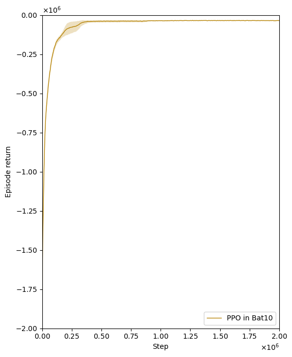
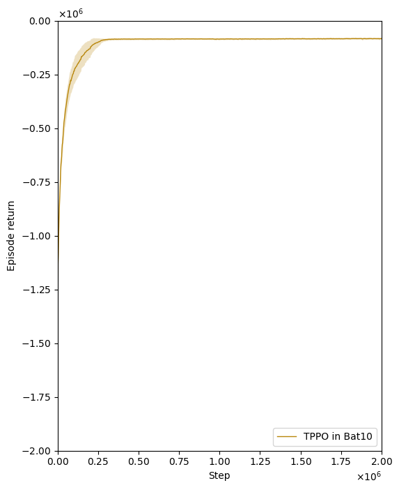
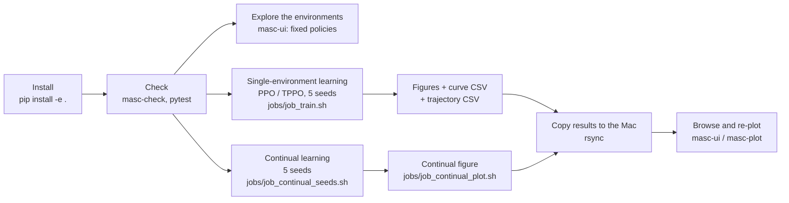

# MASC_ThreeAgent2026

Multi-agent reinforcement learning for inventory management in a serial three-stage supply chain
(**factory → warehouse → retailer**). Every stage is an independent agent with its own policy, trained with
multi-agent **PPO** in [Ray RLlib](https://docs.ray.io/en/latest/rllib/) (new API stack). Two policy networks are
compared: a feed-forward network (**PPO**) and a gated transformer (**Transformer PPO, TPPO**). The project covers
single-environment learning with several random seeds, continual learning across environments, and a local web
interface. Everything is one pip-installable Python package, `masc`.

### Directory structure

```
MASC_Code/
├── pyproject.toml              package definition (pip install -e .) and command-line entry points
├── requirements.txt            exact dependency versions (Python 3.10, CPU build of PyTorch)
├── masc/                       the Python package
│   ├── agents/                 supply chain stages: base_agent.py (template), factory.py, warehouse.py, retailer.py
│   ├── demand.py               customer demand: DemandGenerator (daily draw), DemandAgent (batch demand)
│   ├── envs/                   single-planner environments
│   │   ├── base.py             the shared supply chain (POSingAgent1W1F)
│   │   ├── stochastic.py       stochastic demand: Stocha_P0 / Stocha_P01 / Stocha_P1
│   │   └── batch.py            batch demand: Batch_L10 / Batch_L7 / Batch_L3
│   ├── marl_env.py             multi-agent wrapper, environment ids, PPO config (build_ppo_config), Ray start-up
│   ├── models/                 pluggable agent networks: mlp, transformer (transformer.py)
│   ├── train.py                single-environment PPO, training monitor, figures, CSV    → masc-train
│   ├── main_transformerPPO.py  the same with transformer policies                         → masc-train-transformer
│   ├── trajectory.py           trajectory CSV of the trained policies, every seed           → masc-trajectory
│   ├── continual.py            continual learning between environments (6 tasks)          → masc-continual
│   ├── plotting.py             training curves, continual learning curves                 → masc-plot, masc-plot-continual
│   └── ui/                     local web interface for a Mac (server.py, static/index.html) → masc-ui
├── jobs/                       SLURM scripts: job_train.sh, job_continual.sh, job_continual_seeds.sh, job_continual_plot.sh
├── tests/                      pytest suite (no Ray cluster needed)
└── assets/                     figures of this README
```

### Environment IDs

| Environment id | Class | Short name | Customer demand |
|---|---|---|---|
| `StoSupplyEnv-v1` | `masc.envs.stochastic:Stocha_P0` | Sto0 | always 2 (σ = 0) |
| `StoSupplyEnv-v2` | `masc.envs.stochastic:Stocha_P01` | Sto01 | N(2, 0.1²), rounded down, ≥ 0, new draw every day |
| `StoSupplyEnv-v3` | `masc.envs.stochastic:Stocha_P1` | Sto1 | N(2, 1²), rounded down, ≥ 0, new draw every day |
| `BatSupplyEnv-v1` | `masc.envs.batch:Batch_L10` | Bat10 | one draw of N(2, 0.1²) repeated for 10 days |
| `BatSupplyEnv-v2` | `masc.envs.batch:Batch_L7` | Bat7 | the same, repeated for 7 days |
| `BatSupplyEnv-v3` | `masc.envs.batch:Batch_L3` | Bat3 | the same, repeated for 3 days |

The short names are used in figure names, legends and log directories. Old class names such as
`AssembySto:Stocha_P1` are still accepted.

### 🌃 Supply chain environment

- **Episode**: T = 100 days. Every day the stages receive their deliveries (an upstream stage can only ship what it
  has in stock; the missing part is a stockout of that stage and is not delivered later), the retailer serves the
  customer demand, and inventories are clipped to the capacity (30).
- **Event-driven decisions**: the three agents act only on *reorder days*, when the retailer's inventory reaches its
  reorder point and no delivery is pending. One RLlib step is one decision; the days in between are simulated.
- **Observation** of an agent: its own 9 state fields (inventory, reorder point, pending delivery, days to delivery,
  stockouts since the last order, processing time, stockouts of the day, capacity, stockouts of the episode),
  scaled to [0, 1]. Each agent sees only its own state.
- **Action**: the order quantity (0–19) of every stage, and the reorder point (0–9) of the retailer.

| Agent | Holding cost (per unit) | Processing time | Service time to downstream | Lead time |
|---|---|---|---|---|
| Factory | 1000 | 1 | 1 | 1 |
| Warehouse | 5 | 3 | 4 | 4 |
| Retailer | 1000 | 0 | 0 | 4 |

- **Cost** (on reorder days): inventory × holding cost + stockouts since the last order × 10000. With
  `final_costs` (default) the costs not settled yet are charged at the end of the episode.
- **Reward**: `reward_mode="team"` (default, every agent gets minus the total cost), `"individual"` or `"mixed"`,
  scaled by `reward_scale = 1e-4`.
- **Stockout termination**: the original environment ends an episode after 12 stockout days. The experiments use
  `--no-stockout-termination` (every episode runs 100 days), see [Design notes](#design-notes).
- **`team_return`**: the episode return reported everywhere (training curves, figures, CSV files) is minus the total
  cost of the episode in original cost units: every reorder day, the first one included, plus the final settlement.

### PPO hyperparameters

| Parameter | Value |
|---|---|
| Policy / value networks | separate MLPs 64 × 64, tanh (model `mlp`) |
| Learning rate | 1e-4 in the experiments (`--lr`, default 3e-4) |
| γ / λ (GAE) | 0.99 / 0.95 |
| Clip parameter | 0.2 (`--factory-clip` for the factory only) |
| Entropy coefficient | 0.01 |
| Value loss coefficient / value clip | 0.5 / 10 (`--vf-clip`) |
| Gradient clip | 0.5 |
| Train batch / minibatch / epochs | 2048 / 256 / 5 |
| Reward scale / reward mode | 1e-4 / team |

### TPPO hyperparameters

Transformer PPO uses the PPO settings above with a gated transformer (model `transformer`,
[`masc/models/transformer.py`](masc/models/transformer.py)) in place of the MLPs. It follows RLlib's
[attention net example](https://github.com/ray-project/ray/blob/ray-2.6.1/rllib/examples/attention_net.py)
(PPO + GTrXL, old API stack), implemented as a stateful RLModule for the new API stack. Every agent keeps the last
`memory` observations of the episode as its state and attends over the window *memory + current observation*
(positions before the start of the episode are masked): linear input projection + position embedding →
`num_layers` × [LayerNorm → multi-head attention → GRU gate, LayerNorm → position-wise MLP → GRU gate] → LayerNorm →
policy head (MultiDiscrete logits) and value head, sharing the transformer. Step-by-step sampling and sequence
training give identical outputs.

| Option | Default | attention_net.py option |
|---|---|---|
| `--memory` | 20 | `attention_memory_inference` / `attention_memory_training` |
| `--num-layers` | 1 | `attention_num_transformer_units` |
| `--d-model` | 64 | `attention_dim` |
| `--num-heads` | 2 | `attention_num_heads` |
| `--head-dim` | 32 | `attention_head_dim` |
| `--ff-dim` | 64 | `attention_position_wise_mlp_dim` |
| `--gate-bias` | 2.0 | `attention_init_gru_gate_bias` |
| `--max-seq-len` | 20 | `max_seq_len` |
| `--head-hiddens` | 64 | hidden layers of the policy and value heads |

Differences from the old GTrXL: the memory holds observations rather than the hidden states of every layer, and
previous actions / rewards are not fed to the network.

### 🎬 Demo

`masc-ui` is a local web interface for a **Mac** (Python standard library only): choose environments, the algorithm
and every option in forms generated from the command lines, preview the exact commands, run them in a local queue,
follow their logs, browse the results (training curves with the mean ± std of the seeds, figures, re-plotting) and
explore fixed policies of the environments. It is not connected to the cluster and refuses to start on other
systems; results copied from the cluster with `rsync` can be browsed in it.


```bash
mkdir -p runs && masc-ui --root runs      # opens http://localhost:8765/?token=... in the browser
```

The server listens on 127.0.0.1 only and every API call needs the random token of the address opened at start-up.
The local runs execute one after the other (logs in `<root>/ui_local/`); stopping `masc-ui` stops a running training.

---

## 2. 🤖🤖🤖 for each Single-environment learning

Each run trains the three agents on one environment, with one or several random seeds (one Ray Tune trial per seed
and learning rate).

| Algorithm | Command | Network | Figure | Default log directory |
|---|---|---|---|---|
| PPO | `masc-train` | `mlp` | `PPO_<env>.png` | `tu_logs/` |
| Transformer PPO | `masc-train-transformer` | `transformer` | `TPPO_<env>.png` | `tu2_logs/` |

```bash
# experiment setting: team reward, no stockout termination, lr 1e-4, 5 seeds, fixed 2M steps
masc-train --env StoSupplyEnv-v3 --no-stockout-termination --lr 0.0001 --seeds 0 1 2 3 4 \
    --no-early-stop --total-timesteps 2000000 --num-env-runners 2 --dir tu_seeds
masc-train-transformer --env StoSupplyEnv-v3 --no-stockout-termination --lr 0.0001 --seeds 0 1 2 3 4 \
    --no-early-stop --total-timesteps 2000000 --num-env-runners 2 --dir tu2_seeds
```

| PPO, Bat10, 5 seeds | Transformer PPO, Bat10, 5 seeds |
|---|---|
|  |  |

**Training monitor.** Every iteration the reward curve of a trial is checked over moving windows of
`--conv-window` iterations: *converged* (stable within `--conv-tol` for `--conv-patience` iterations, near its best
and improved by `--min-gain`), *collapsed*, *stalled*, *diverged*, or the step / time limit. A trial stops at its
verdict, or with `--no-early-stop` runs to `--total-timesteps` and only records the first step of every verdict
(`would_stop` in `training_status.json`). The defaults (tolerance 1 %, window 50, patience 100) stop on average at
1.14M steps, 0.6 % below the return reached after 3M steps (calibrated on 24 complete curves).

**Outputs** (under `--out-dir`, default the current directory):

| File | Content |
|---|---|
| `<dir>_logs/<env>/<time>/` | TensorBoard logs, `progress.csv`, `params.json`, checkpoints of every trial |
| `<dir>_logs/<env>/<time>/training_status.json` | lr, seed, verdict, steps, reason, `would_stop`, checkpoint of every trial |
| `PPO_<env>.png`, `TPPO_<env>.png` | training curve; several seeds: mean (line) ± std (band) |
| `csv_results/<tag>_curve.csv` | step, team return mean / std / number of seeds |
| `csv_results/<tag>_trajectory.csv` | the trained policies of every seed: one deterministic episode of 100 days each (5 seeds → 500 rows) |

The trajectory CSV contains only the converged policies, not the training: columns `seed`, `demand_seed`, `day`,
then `<agent>_<state>` (inventory, reorderpoint, pendingDelivery, daysDelivery, stockout_cum, processingTimes,
stockout_daily, capacity, stockout_total), `<agent>_<action>` (serviceTime, orderToSupplier, reorderPoint, executed
on reorder days), `customer_demand`, `Cost` (negative; the 100 days of a seed add up to its episode total cost) and
`retailer_actionTriggerHistory`. `masc-trajectory <run directory>` writes it for an existing run.

### Design notes

The first runs (individual rewards, unscaled rewards, lr 3e-3, termination after 12 stockout days) collapsed in every
environment. The fixes and their evidence:

| Problem | Symptom | Fix |
|---|---|---|
| Unscaled rewards | value function never learned (explained variance 0, value loss ~1e10) | `reward_scale = 1e-4` |
| Too large updates | KL spikes, then collapse; deterministic policies | lr 1e-4, entropy 0.01, minibatch 256, 5 epochs |
| Early termination | agents learned to stop ordering and end the episode (cost −1.97e5 vs −0.9e5 for good policies) | final settlement of the costs; no stockout termination in training |
| Individual rewards | the factory stopped supplying to save holding costs, cascading stockouts downstream | team reward |
| Value losses exploding at KL spikes | value loss up to ~3500 dominated the clipped gradients | `vf_clip_param = 10` |

Longer training does not close the remaining gap to the best fixed policy: in 18 of 24 trials the deterministic
policy at 3M steps is identical to the one at convergence; the gap comes from the local optimum reached by each seed,
hence the 5-seed experiments.

**Best fixed policies** (grid search over a common order quantity q of all stages or upstream q = 19 and the retailer
reorder point rp, evaluated on 50 test seeds, no stockout termination):

| | Bat10 | Bat7 | Bat3 | Sto0 | Sto01 | Sto1 |
|---|---|---|---|---|---|---|
| (q, rp) | (18, 6) | (19, 7) | (18, 7) | (18, 6) | (19, 6) | (19, 7) |
| Total cost | 71,840 | 75,260 | 77,800 | 94,000 | 63,640 | 84,680 |

---

## 3. 🤖*81 for each Continual learning

The agents are trained on a sequence of environments; every phase starts from the policies of the previous phase,
and the sequence is repeated for several rounds. The observations of all environments have the same 9 rows, so the
policies transfer between them.

| Task (`--task`) | Sequence | Default rounds | Model directory |
|---|---|---|---|
| `0-01-1` | Sto0 → Sto01 → Sto1 | 3 (9 phases) | `PPOcon-sto_models/` |
| `1-01-0` | Sto1 → Sto01 → Sto0 | 3 | `PPOcon-sto_models/` |
| `3-7-10` | Bat3 → Bat7 → Bat10 | 3 | `PPOcon-bat_models/` |
| `10-7-3` | Bat10 → Bat7 → Bat3 | 3 | `PPOcon-bat_models/` |
| `bat10-sto1` | Bat10 → Sto1 | 5 | `PPOconbat-sto_models/` |
| `sto1-bat10` | Sto1 → Bat10 | 5 | `PPOconbat-sto_models/` |

```bash
# one run
masc-continual --task 0-01-1 --lr 0.0001 --timesteps-per-phase 1000000 --no-stockout-termination
# several seeds of one experiment (one run per seed, no figure during the training), then one figure
masc-continual --task 0-01-1 --seed 0 --run-name exp1 --no-figure --no-monitor --lr 0.0001 \
    --timesteps-per-phase 1000000 --no-stockout-termination      # ... and seeds 1-4
masc-plot-continual --seeds PPOcon-sto_models/0-01-1/exp1
```

Every iteration writes `phase<i>_<env>/team_return` to TensorBoard (`<models dir>/<task>/<run>/[seed=<s>/]lr=<lr>/tb`),
the checkpoint of every phase is kept for the next phase, and `continual_status.json` holds the settings and the test
return of every phase. The figure is drawn once at the end, in the style of
[dcontinustoPPO2_2.png](assets/dcontinustoPPO2_2.png): one segment per phase in the colour of its environment
(mean ± std of the seeds), dotted lines and labels at the start of every round, e.g.
`PPOcon_Sto0-Sto01-Sto1_3rounds_1Msteps-per-phase_lr0.0001_5seeds_<run>.png`. A monitor stops a task that diverges,
collapses or does not learn in the first phase (`--no-monitor` to switch it off).

---

## 4. 📦 Installation

Python 3.10–3.12. Install the exact versions of `requirements.txt` first (Ray 2.49.2, PyTorch 2.2.2 CPU build,
Gymnasium 1.1.1, NumPy 1.26.4, TensorBoard, ...), then the package:

```bash
conda create -n MASC python=3.10 -y && conda activate MASC
git clone https://github.com/wangwan0910/MASC_ThreeAgent2026.git && cd MASC_ThreeAgent2026
pip install -r requirements.txt
pip install -e .                 # editable: changes in masc/ take effect immediately
masc-check                       # every environment runs one random episode
pip install -e ".[dev]" && pytest   # optional: the test suite
```

- On a cluster without internet on the compute nodes (e.g. Iridis), create the environment on a login node. The
  SLURM scripts activate the conda environment `MASC` (other name: `CONDA_ENV=xxx sbatch ...`).
- On Linux, `requirements.txt` installs the CPU build of PyTorch (the default wheel downloads ~3 GB of CUDA
  libraries). For GPU training (`--num-gpus 1`) install the CUDA build instead.
- On a Mac the same commands work; `masc-ui` is only available there.

---

## 5. 🔁 Workflow



1. Install the package and run `masc-check` (and `pytest`).
2. Explore the environments and the best fixed policies in `masc-ui` (Mac) or with Python.
3. Train PPO and Transformer PPO on the six environments with five seeds on the cluster (`jobs/job_train.sh`).
4. Run the continual learning experiments with five seeds (`jobs/job_continual_seeds.sh` + `jobs/job_continual_plot.sh`).
5. Use the figures and the CSV files; copy the logs to a Mac (`rsync`) to browse and re-plot them in `masc-ui`.

---

## 6. 🛠️ Usage

### Commands

| Command | Module | Purpose |
|---|---|---|
| `masc-train` | `masc.train` | single-environment PPO |
| `masc-train-transformer` | `masc.main_transformerPPO` | single-environment Transformer PPO |
| `masc-continual` | `masc.continual` | continual learning |
| `masc-trajectory` | `masc.trajectory` | trajectory CSV of an existing run |
| `masc-plot` | `masc.plotting` | training curve of a run (`--seeds`: mean ± std) |
| `masc-plot-continual` | `masc.plotting` | continual learning curve (`--seeds`: mean ± std of the seeds) |
| `masc-check` | `masc.marl_env` | run every environment once |
| `masc-ui` | `masc.ui.server` | local web interface (Mac) |

Every command has `--help`. Main options of `masc-train` / `masc-train-transformer`:

| Option | Default | Meaning |
|---|---|---|
| `--env` | required | environment id |
| `--lr` | 3e-4 | one or several learning rates (grid search) |
| `--seeds` | not fixed | one or several random seeds (networks and demand) |
| `--reward-mode` / `--reward-scale` | team / 1e-4 | reward of the agents |
| `--no-stockout-termination` | off | every episode runs 100 days |
| `--total-timesteps` / `--no-early-stop` | 9e6 / off | step limit; run to the limit without stopping at a verdict |
| `--vf-clip` / `--factory-clip` | 10 / 0.2 | value clip; clip parameter of the factory |
| `--num-env-runners` | 1 | sampling workers per trial (a trial uses 1 + n CPUs) |
| `--out-dir`, `--dir`, `--tag` | `.`, `tu`, none | output directory, log directory, suffix of the figure / CSV names |

### On a SLURM cluster

The job scripts write everything to the directory they are submitted from.

| Script | Array tasks |
|---|---|
| `jobs/job_train.sh` | 0 Bat10, 1 Bat7, 2 Bat3, 3 Sto1, 4 Sto01, 5 Sto0 (`ALGO=ppo` or `ALGO=transformer`) |
| `jobs/job_continual.sh` | 0 `0-01-1`, 1 `1-01-0`, 2 `3-7-10`, 3 `10-7-3`, 4 `bat10-sto1`, 5 `sto1-bat10` |
| `jobs/job_continual_seeds.sh` | one task per seed of one continual learning task (`TASK`, default `0-01-1`) |
| `jobs/job_continual_plot.sh` | figure of all the seeds of a continual learning experiment |

```bash
mkdir -p runs && cd runs
ARGS="--seeds 0 1 2 3 4 --lr 0.0001 --no-early-stop --total-timesteps 2000000 --num-env-runners 2"
sbatch ../jobs/job_train.sh $ARGS --dir tu_seeds                                   # PPO, six environments
ALGO=transformer sbatch --mem=40G ../jobs/job_train.sh $ARGS --dir tu2_seeds       # Transformer PPO
RUN=$(date +%Y%m%d-%H%M%S)
J=$(RUN_NAME=$RUN sbatch --parsable ../jobs/job_continual_seeds.sh --lr 0.0001 \
    --timesteps-per-phase 1000000 --num-env-runners 4 --no-stockout-termination)
sbatch --dependency=afterany:${J%%_*} ../jobs/job_continual_plot.sh PPOcon-sto_models/0-01-1/$RUN
```

Notes: Transformer PPO with five seeds needs up to ~22 GB per job (request 40 GB) and about 10 h for 2M steps. The
scripts start Ray with a random delay and retry once if it fails to start (many jobs on one node); a run that does
not converge exits with code 1 (SLURM state FAILED, the reason is in `training_status.json`).

### Python

```python
import numpy as np
from masc.marl_env import SupplyChainMARLEnv, build_ppo_config

env = SupplyChainMARLEnv({"env_class": "BatSupplyEnv-v1", "max_stockout_days": 0})
obs, info = env.reset(seed=0)
obs, rewards, terminated, truncated, info = env.step(
    {"factory": np.array([0, 18, 0]), "warehouse": np.array([0, 18, 0]), "retailer": np.array([0, 18, 6])})

config = build_ppo_config({"env_class": "BatSupplyEnv-v1", "max_stockout_days": 0}, lr=1e-4, seed=0,
                          model="transformer", model_config={"memory": 30})
```

### Extending

- **A new network**: write a TorchRLModule (with `ValueFunctionAPI` for PPO), register a builder with
  `masc.models.register_model("<name>", defaults={...})`, use it with `build_ppo_config(model="<name>")`, add an entry
  script like `masc/main_transformerPPO.py`, and one line in `COMMANDS` / `ALGORITHMS` of `masc/ui/server.py`.
- **A new stage**: derive from `BaseAgent` in `masc/agents/` and add it to `make_agents()`; spaces, costs, CSV columns
  and the wrapper follow the list of agents (the last one must be a `Retailer`).
- **A new demand process**: derive from `POSingAgent1W1F` in `masc/envs/`, implement `gen_demand()`, and register an
  id in `ENV_IDS` / `ENV_SHORT_NAMES` and a colour in `masc.plotting.ENV_COLORS`.

---

## 7. ⭐️ Tasks

| Group | Tasks | Algorithms | Setting | Output |
|---|---|---|---|---|
| Single-environment learning | Bat10, Bat7, Bat3, Sto0, Sto01, Sto1 | PPO, Transformer PPO | 5 seeds, lr 1e-4, 2M steps, no stockout termination | `PPO_<env>.png`, `TPPO_<env>.png`, curve and trajectory CSV |
| Continual learning, stochastic demand | `0-01-1`, `1-01-0` | PPO | 3 rounds (9 phases), 1M steps per phase, 5 seeds | `PPOcon_<sequence>_..._5seeds_<run>.png` |
| Continual learning, batch demand | `3-7-10`, `10-7-3` | PPO | as above | as above |
| Continual learning, stochastic ↔ batch | `bat10-sto1`, `sto1-bat10` | PPO | 5 rounds | as above |
| Baseline | the six environments | best fixed policy | grid search, 50 test seeds | table in [Design notes](#design-notes) |

Figure conventions (all figures): Bat10 darkgoldenrod, Bat7 goldenrod, Bat3 gold, Sto0 dodgerblue, Sto01
lightskyblue, Sto1 skyblue; both axes in scientific notation; single-environment figures with the legend in the
lower right and common axis limits (x 0–2×10⁶, y −2×10⁶–0, `masc.plotting.XLIM / YLIM`).

---

## 8. 🎉 Acknowledgments

- [Ray RLlib and Tune](https://docs.ray.io/) for multi-agent PPO, the RLModule API and the experiment management;
  the transformer policy follows RLlib's
  [attention net example](https://github.com/ray-project/ray/blob/ray-2.6.1/rllib/examples/attention_net.py).
- E. Parisotto et al., *Stabilizing Transformers for Reinforcement Learning* (ICML 2020), for the gated transformer
  (GTrXL).
- [Gymnasium](https://gymnasium.farama.org/), [PyTorch](https://pytorch.org/),
  [TensorBoard](https://www.tensorflow.org/tensorboard) and [Matplotlib](https://matplotlib.org/).
- The Iridis High Performance Computing Facility of the University of Southampton, on which the experiments were run.
