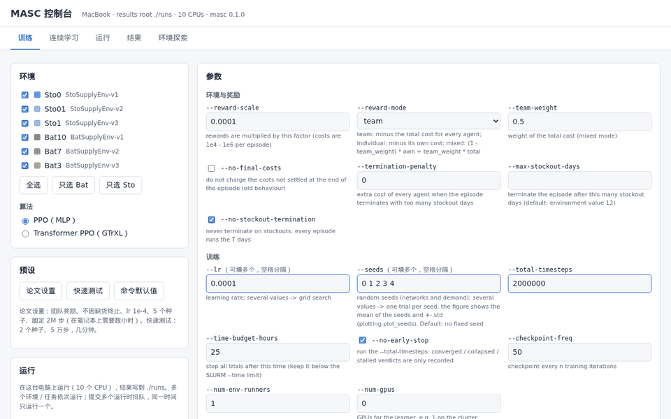
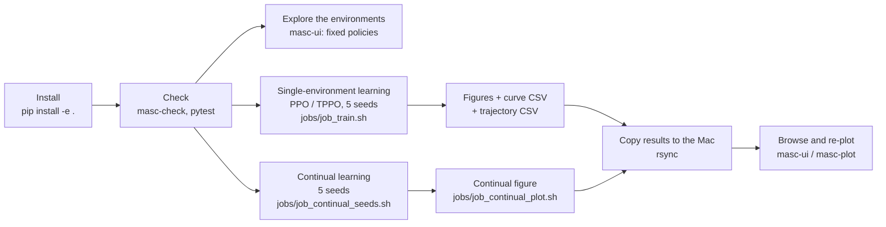

# MASC_ThreeAgent2026

Multi-agent reinforcement learning for inventory management in a serial three-stage supply chain
(**factory → warehouse → retailer**). Every stage is an independent agent with its own policy, trained with
multi-agent **PPO** in [Ray RLlib](https://docs.ray.io/en/latest/rllib/) (new API stack). Two policy networks are
compared: a feed-forward network (**PPO**) and a gated transformer (**Transformer PPO, TPPO**). The project covers
single-environment learning with several random seeds, continual learning across environments, and a local web
interface. Everything is one pip-installable Python package, `masc`.

### Environment IDs

| Environment id | Class | Short name | Customer demand |
|---|---|---|---|
| `StoSupplyEnv-v1` | `masc.envs.stochastic:Stocha_P0` | Sto0 | always 2 (σ = 0) |
| `StoSupplyEnv-v2` | `masc.envs.stochastic:Stocha_P01` | Sto01 | N(2, 0.1²), rounded down, ≥ 0, new draw every day |
| `StoSupplyEnv-v3` | `masc.envs.stochastic:Stocha_P1` | Sto1 | N(2, 1²), rounded down, ≥ 0, new draw every day |
| `BatSupplyEnv-v1` | `masc.envs.batch:Batch_L10` | Bat10 | one draw of N(2, 0.1²) repeated for 10 days |
| `BatSupplyEnv-v2` | `masc.envs.batch:Batch_L7` | Bat7 | the same, repeated for 7 days |
| `BatSupplyEnv-v3` | `masc.envs.batch:Batch_L3` | Bat3 | the same, repeated for 3 days |

The short names are used in figure names, legends and log directories. Old class names such as
`AssembySto:Stocha_P1` are still accepted.

### 🌃 Supply chain environment

**Chain**: external supplier → factory → warehouse → retailer → customer. Every stage is one agent with its own
policy (no parameter sharing). The supply chain is defined in `masc/envs/base.py` and `masc/agents/`.

| Agent | Holding cost (per unit per day) | Processing time | Initial inventory | Inventory range |
|---|---|---|---|---|
| Factory | 1000 | 1 | 0 | 0–29 |
| Warehouse | 5 | 3 | 0 | 0–29 |
| Retailer | 1000 | 1 | 10 (initial reorder point 5) | 0–29 |

A stockout costs 10000 per unit, at every stage. Inventory above 29 is lost at the end of the day.

**Customer demand** (see [Environment IDs](#environment-ids)): the normal draw is rounded down, so with σ = 0.1 a
draw just below 2 gives 1. The mean demand is about 1.5 in Sto01 and in the batch environments, and 2 in Sto0.

**One day** (`Pre_step`), in this order:
1. **Deliveries**, from upstream to downstream. When an order is due, the supplier ships min(order, its
   inventory). The missing part is a stockout of the supplier and is lost (not delivered later). The external
   supplier is unlimited.
2. **Customer demand**: the retailer serves the demand from its inventory, the goods that arrived this day included.
   Unmet demand is a stockout and is lost (lost sales).
3. **Reorder trigger**: the day is a *reorder day* if the retailer's inventory ≤ its reorder point and the retailer
   has no order in transit.
4. **Capacity**: inventories are clipped to 0–29.

**Actions (reorder days only)**: the three agents act on the same reorder days; the factory and the warehouse have
no trigger of their own.

| Agent | Order quantity | Reorder point | Service time action |
|---|---|---|---|
| Factory | 0–30 | not used | none (set by the environment) |
| Warehouse | 0–30 | not used | none (set by the environment) |
| Retailer | 0–30 | 0–29 | none (always 0) |

The service time dimension has a single value (`action_nvec` first entry 1) for every agent, so the policies output
no logits for it. The orders are placed from upstream to downstream. An agent with an order still in transit does
not order again: the order in transit is kept and the recorded order quantity is 0. An order of 0 units is no order:
nothing is put in transit, so the agent can order again on the next reorder day.

**Lead times** depend on the stock of the supplier on the reorder day ("in stock" = inventory ≥ the downstream
order):

| Order of | Condition | Lead time (days) |
|---|---|---|
| Factory | always (external supplier) | 1 |
| Warehouse | factory in stock (ST0 = 0) | 3 |
| | factory out of stock (ST0 = 1, it waits for its own replenishment) | 4 |
| Retailer | warehouse in stock | 1 |
| | warehouse out of stock, factory in stock | 3 (forwarded the day the warehouse's replenishment arrives) |
| | warehouse and factory out of stock | 4 |
| | warehouse out of stock with an earlier order still in transit | days left of that order (at least 1) |
| | warehouse out of stock with nothing in transit | 1 (the warehouse ships what it has, the rest is lost) |

An order placed at the end of day d with lead time L arrives at the start of day d + L and can be sold that day.
From the retailer's point of view the lead time is at most 4 days.

**Cost, reward and return**:
- **Cost** on a reorder day (before the actions are executed): for every stage, inventory × holding cost + stockouts
  since the last reorder day × 10000. The stockout counter is reset on every reorder day.
- **Reward** (sparse, reorder days only): `reward_mode="team"` (default, every agent gets minus the total cost),
  `"individual"` (minus its own cost) or `"mixed"`, scaled by `reward_scale = 1e-4`. With `final_costs` (default)
  the costs not settled yet (stockouts since the last reorder day) are charged on the last step of the episode. The
  cost of the first reorder day comes from the initial state and is not a reward.
- **`team_return`**: the episode return reported everywhere (training curves, figures, CSV files) is minus the total
  cost of the episode in original cost units: every reorder day, the first one included, plus the final settlement.

**Episode and RLlib steps**:
- **Episode**: T = 100 days. The original environment ends an episode after 12 days with a retailer stockout; the
  experiments use `--no-stockout-termination` (every episode runs 100 days), see [Design notes](#design-notes).
- **Event driven**: one RLlib step is one reorder day. The days in between are simulated without action and give no
  training sample, so gamma discounts per decision, not per day.
- **Observation** of an agent: its own 9 state fields (inventory, reorder point, pending delivery, days to delivery,
  stockouts since the last reorder day, processing time, stockouts of the day, capacity, stockouts of the episode),
  scaled to [0, 1]. Each agent sees only its own state.

**Points to keep in mind**:
- The factory orders on every reorder day, even when the warehouse does not order; the policy has to learn to order
  0 at the factory, otherwise the factory inventory grows.
- A supplier with part of the order in stock counts as out of stock: the order gets the longer lead time, and the
  supplier ships what it has on the delivery day.
- The lead times and action ranges above date from 2026-10-15. Models trained before (fixed lead times 1 / 4 / 4,
  orders 0–19, reorder point 0–9) are not comparable and must be retrained.

### PPO hyperparameters

| Parameter | Value |
|---|---|
| Policy / value networks | separate MLPs 64 × 64, tanh (model `mlp`) |
| Learning rate | 1e-4 in the experiments (`--lr`, default 3e-4) |
| γ / λ (GAE) | 0.99 / 0.95 |
| Clip parameter | 0.2 (`--factory-clip` for the factory only) |
| Entropy coefficient | 0.01 |
| Value loss coefficient / value clip | 0.5 / 10 (`--vf-clip`) |
| Gradient clip | 0.5 |
| Train batch / minibatch / epochs | 2048 / 256 / 5 |
| Reward scale / reward mode | 1e-4 / team |

### TPPO hyperparameters

Transformer PPO uses the PPO settings above, with a gated transformer (GTrXL, [transformer.py](masc/models/transformer.py))
in place of the MLPs, following RLlib's
[attention net example](https://github.com/ray-project/ray/blob/ray-2.6.1/rllib/examples/attention_net.py)
(PPO + GTrXL). The policy and value heads share the transformer.

Every agent keeps the last $M$ observations of the episode. At step $t$ it attends over the window of $M + 1$
observations $o_{t-M}, \dots, o_t$ (positions before the start of the episode are masked):

$$x^{(0)}_i = W_{in}\, o_{t-M+i} + p_i, \qquad i = 0, \dots, M$$

For every layer $l = 1, \dots, L$:

$$y = \mathrm{ReLU}\big(\mathrm{MHA}(\mathrm{LN}(x^{(l-1)}))\big), \qquad u = g\big(x^{(l-1)}, y\big)$$

$$x^{(l)} = g\Big(u,\ \mathrm{ReLU}\big(W_2\, \mathrm{ReLU}(W_1\, \mathrm{LN}(u))\big)\Big)$$

with the GRU gate $g(x, y)$:

$$r = \sigma(W_r y + U_r x), \qquad z = \sigma(W_z y + U_z x - b_g), \qquad
h = \tanh\big(W_h y + U_h (r \odot x)\big), \qquad g(x, y) = (1 - z) \odot x + z \odot h$$

The embedding of the current step is $e_t = \mathrm{LN}(x^{(L)}_M)$; the policy head gives the MultiDiscrete logits
$\pi(a_t \mid o_{t-M..t})$ and the value head $V(o_{t-M..t})$, both MLPs on $e_t$.

| Parameter | Value |
|---|---|
| Memory length $M$ (window $M + 1$) | 20 |
| Transformer layers $L$ | 1 |
| Model dimension $d_{model}$ | 64 |
| Attention heads $H$ / head dimension $d_h$ | 2 / 32 |
| Position-wise MLP dimension $d_{ff}$ | 64 |
| GRU gate bias $b_g$ | 2.0 (gates start close to the identity) |
| Maximum training sequence length | 20 |
| Policy / value heads | MLP 64, tanh, on the shared $e_t$ |
| Other PPO settings | as in [PPO hyperparameters](#ppo-hyperparameters) |

Differences from the old GTrXL: the memory holds observations rather than the hidden states of every layer, and
previous actions / rewards are not fed to the network. Step-by-step sampling and sequence training give identical
outputs.

### 🎬 Demo

`masc-ui` is a local web interface for a **Mac** (Python standard library only): choose environments, the algorithm
and every option in forms generated from the command lines, preview the exact commands, run them in a local queue,
follow their logs, browse the results (training curves with the mean ± std of the seeds, figures, re-plotting) and
explore fixed policies of the environments. It is not connected to the cluster and refuses to start on other
systems; results copied from the cluster with `rsync` can be browsed in it.



```bash
mkdir -p runs && masc-ui --root runs      # opens http://localhost:8765/?token=... in the browser
```

The server listens on 127.0.0.1 only and every API call needs the random token of the address opened at start-up.
The local runs execute one after the other (logs in `<root>/ui_local/`); stopping `masc-ui` stops a running training.

---

## 2. 🤖🤖🤖 for each Single-environment learning

Each run trains the three agents on one environment, with one or several random seeds (one Ray Tune trial per seed
and learning rate).

| Algorithm | Command | Network | Figure | Default log directory |
|---|---|---|---|---|
| PPO | `masc-train` | `mlp` | `PPO_<env>.png` | `tu_logs/` |
| Transformer PPO | `masc-train-transformer` | `transformer` | `TPPO_<env>.png` | `tu2_logs/` |

```bash
# experiment setting: team reward, no stockout termination, lr 1e-4, 5 seeds, fixed 2M steps
masc-train --env StoSupplyEnv-v3 --no-stockout-termination --lr 0.0001 --seeds 0 1 2 3 4 \
    --no-early-stop --total-timesteps 2000000 --num-env-runners 2 --dir tu_seeds
masc-train-transformer --env StoSupplyEnv-v3 --no-stockout-termination --lr 0.0001 --seeds 0 1 2 3 4 \
    --no-early-stop --total-timesteps 2000000 --num-env-runners 2 --dir tu2_seeds
```


Total cost of the trained policies (one deterministic 100-day episode per seed, from the trajectory CSV):

| | Bat10 | Bat7 | Bat3 | Sto0 | Sto01 | Sto1 |
|---|---|---|---|---|---|---|
| Mean ± std of 5 seeds | 43,597 ± 11,730 | 38,804 ± 16,666 | 59,042 ± 12,776 | 64,917 ± 30,105 | 31,497 ± 14,085 | 47,847 ± 29,351 |
| Best seed | 32,355 | 18,500 | 37,500 | 30,240 | 14,760 | 20,660 |

**Learned policies** (seed with the least total cost, `masc-plot-policy`, 100 days). Order figures: orders of the three
agents and the retailer's reorder point, which is only set on reorder days (markers) and kept in between. Inventory
figures: inventory of the three agents and the retailer's cumulative stockout. In every environment most seeds
converge to the same policy: retailer orders ≈ 12, warehouse and factory ≈ 25, reorder point 1. The mean demand is
almost the same in all environments (≈ 1.5 per day after rounding down, 2 in Sto0) and so are the costs and lead
times.


Transformer PPO, Bat10, 5 seeds (environment before 2026-10-15, fixed lead times and orders 0–19, not comparable
with the PPO results above):


**Training monitor.** Every iteration the reward curve of a trial is checked over moving windows of
`--conv-window` iterations: *converged* (stable within `--conv-tol` for `--conv-patience` iterations, near its best
and improved by `--min-gain`), *collapsed*, *stalled*, *diverged*, or the step / time limit. A trial stops at its
verdict, or with `--no-early-stop` runs to `--total-timesteps` and only records the first step of every verdict
(`would_stop` in `training_status.json`). The defaults (tolerance 1 %, window 50, patience 100) stop on average at
1.14M steps, 0.6 % below the return reached after 3M steps (calibrated on 24 complete curves).

**Outputs** (under `--out-dir`, default the current directory):

| File | Content |
|---|---|
| `<dir>_logs/<env>/<time>/` | TensorBoard logs, `progress.csv`, `params.json`, checkpoints of every trial |
| `<dir>_logs/<env>/<time>/training_status.json` | lr, seed, verdict, steps, reason, `would_stop`, checkpoint of every trial |
| `PPO_<env>.png`, `TPPO_<env>.png` | training curve; several seeds: mean (line) ± std (band) |
| `csv_results/<tag>_curve.csv` | step, team return mean / std / number of seeds |
| `csv_results/<tag>_trajectory.csv` | the trained policies of every seed: one deterministic episode of 100 days each (5 seeds → 500 rows) |

The trajectory CSV contains only the converged policies, not the training: columns `seed`, `demand_seed`, `day`,
then `<agent>_<state>` (inventory, reorderpoint, pendingDelivery, daysDelivery, stockout_cum, processingTimes,
stockout_daily, capacity, stockout_total), `<agent>_<action>` (serviceTime, orderToSupplier, reorderPoint, executed
on reorder days), `customer_demand`, `Cost` (negative; the 100 days of a seed add up to its episode total cost) and
`retailer_actionTriggerHistory`. `masc-trajectory <run directory>` writes it for an existing run.

### Design notes

The first runs (individual rewards, unscaled rewards, lr 3e-3, termination after 12 stockout days) collapsed in every
environment. The fixes and their evidence:

| Problem | Symptom | Fix |
|---|---|---|
| Unscaled rewards | value function never learned (explained variance 0, value loss ~1e10) | `reward_scale = 1e-4` |
| Too large updates | KL spikes, then collapse; deterministic policies | lr 1e-4, entropy 0.01, minibatch 256, 5 epochs |
| Early termination | agents learned to stop ordering and end the episode (cost −1.97e5 vs −0.9e5 for good policies) | final settlement of the costs; no stockout termination in training |
| Individual rewards | the factory stopped supplying to save holding costs, cascading stockouts downstream | team reward |
| Value losses exploding at KL spikes | value loss up to ~3500 dominated the clipped gradients | `vf_clip_param = 10` |

Longer training does not close the remaining gap to the best fixed policy: in 18 of 24 trials the deterministic
policy at 3M steps is identical to the one at convergence; the gap comes from the local optimum reached by each seed,
hence the 5-seed experiments.

**Best fixed policies** (grid search over a common order quantity q of all stages or upstream q = 19 and the retailer
reorder point rp, evaluated on 50 test seeds, no stockout termination; computed with the environment before
2026-10-15, fixed lead times and orders 0–19):

| | Bat10 | Bat7 | Bat3 | Sto0 | Sto01 | Sto1 |
|---|---|---|---|---|---|---|
| (q, rp) | (18, 6) | (19, 7) | (18, 7) | (18, 6) | (19, 6) | (19, 7) |
| Total cost | 71,840 | 75,260 | 77,800 | 94,000 | 63,640 | 84,680 |

---

## 3. 🤖*81 for each Continual learning

The agents are trained on a sequence of environments; every phase starts from the policies of the previous phase,
and the sequence is repeated for several rounds. The observations of all environments have the same 9 rows, so the
policies transfer between them.

| Task (`--task`) | Sequence | Default rounds | Model directory |
|---|---|---|---|
| `0-01-1` | Sto0 → Sto01 → Sto1 | 3 (9 phases) | `PPOcon-sto_models/` |
| `1-01-0` | Sto1 → Sto01 → Sto0 | 3 | `PPOcon-sto_models/` |
| `3-7-10` | Bat3 → Bat7 → Bat10 | 3 | `PPOcon-bat_models/` |
| `10-7-3` | Bat10 → Bat7 → Bat3 | 3 | `PPOcon-bat_models/` |
| `bat10-sto1` | Bat10 → Sto1 | 5 | `PPOconbat-sto_models/` |
| `sto1-bat10` | Sto1 → Bat10 | 5 | `PPOconbat-sto_models/` |

```bash
# one run
masc-continual --task 0-01-1 --lr 0.0001 --timesteps-per-phase 1000000 --no-stockout-termination
# several seeds of one experiment (one run per seed, no figure during the training), then one figure
masc-continual --task 0-01-1 --seed 0 --run-name exp1 --no-figure --no-monitor --lr 0.0001 \
    --timesteps-per-phase 1000000 --no-stockout-termination      # ... and seeds 1-4
masc-plot-continual --seeds PPOcon-sto_models/0-01-1/exp1
```

## 4. 📦 Installation

Python 3.10–3.12. Install the exact versions of `requirements.txt` first (Ray 2.49.2, PyTorch 2.2.2 CPU build,
Gymnasium 1.1.1, NumPy 1.26.4, TensorBoard, ...), then the package:

```bash
conda create -n MASC python=3.10 -y && conda activate MASC
git clone https://github.com/wangwan0910/MASC_ThreeAgent2026.git && cd MASC_ThreeAgent2026
pip install -r requirements.txt
pip install -e .                 # editable: changes in masc/ take effect immediately
masc-check                       # every environment runs one random episode
pip install -e ".[dev]" && pytest   # optional: the test suite
```

- On a cluster without internet on the compute nodes (e.g. Iridis), create the environment on a login node. The
  SLURM scripts activate the conda environment `MASC` (other name: `CONDA_ENV=xxx sbatch ...`).
- On Linux, `requirements.txt` installs the CPU build of PyTorch (the default wheel downloads ~3 GB of CUDA
  libraries). For GPU training (`--num-gpus 1`) install the CUDA build instead.
- On a Mac the same commands work; `masc-ui` is only available there.

---

## 5. 🔁 Workflow



1. Install the package and run `masc-check` (and `pytest`).
2. Explore the environments and the best fixed policies in `masc-ui` (Mac) or with Python.
3. Train PPO and Transformer PPO on the six environments with five seeds on the cluster (`jobs/job_train.sh`).
4. Run the continual learning experiments with five seeds (`jobs/job_continual_seeds.sh` + `jobs/job_continual_plot.sh`).
5. Use the figures and the CSV files; copy the logs to a Mac (`rsync`) to browse and re-plot them in `masc-ui`.

---

## 6. 🛠️ Usage

### Commands

| Command | Module | Purpose |
|---|---|---|
| `masc-train` | `masc.train` | single-environment PPO |
| `masc-train-transformer` | `masc.main_transformerPPO` | single-environment Transformer PPO |
| `masc-continual` | `masc.continual` | continual learning |
| `masc-trajectory` | `masc.trajectory` | trajectory CSV of an existing run |
| `masc-plot` | `masc.plotting` | training curve of a run (`--seeds`: mean ± std) |
| `masc-plot-continual` | `masc.plotting` | continual learning curve (`--seeds`: mean ± std of the seeds) |
| `masc-check` | `masc.marl_env` | run every environment once |
| `masc-ui` | `masc.ui.server` | local web interface (Mac) |

Every command has `--help`. Main options of `masc-train` / `masc-train-transformer`:

| Option | Default | Meaning |
|---|---|---|
| `--env` | required | environment id |
| `--lr` | 3e-4 | one or several learning rates (grid search) |
| `--seeds` | not fixed | one or several random seeds (networks and demand) |
| `--reward-mode` / `--reward-scale` | team / 1e-4 | reward of the agents |
| `--no-stockout-termination` | off | every episode runs 100 days |
| `--total-timesteps` / `--no-early-stop` | 9e6 / off | step limit; run to the limit without stopping at a verdict |
| `--vf-clip` / `--factory-clip` | 10 / 0.2 | value clip; clip parameter of the factory |
| `--num-env-runners` | 1 | sampling workers per trial (a trial uses 1 + n CPUs) |
| `--out-dir`, `--dir`, `--tag` | `.`, `tu`, none | output directory, log directory, suffix of the figure / CSV names |

### Python

```python
import numpy as np
from masc.marl_env import SupplyChainMARLEnv, build_ppo_config

env = SupplyChainMARLEnv({"env_class": "BatSupplyEnv-v1", "max_stockout_days": 0})
obs, info = env.reset(seed=0)
obs, rewards, terminated, truncated, info = env.step(
    {"factory": np.array([0, 18, 0]), "warehouse": np.array([0, 18, 0]), "retailer": np.array([0, 18, 6])})

config = build_ppo_config({"env_class": "BatSupplyEnv-v1", "max_stockout_days": 0}, lr=1e-4, seed=0,
                          model="transformer", model_config={"memory": 30})
```

---

## 7. ⭐️ Tasks

| Group | Tasks | Algorithms | Setting | Output |
|---|---|---|---|---|
| Single-environment learning | Bat10, Bat7, Bat3, Sto0, Sto01, Sto1 | PPO, Transformer PPO | 5 seeds, lr 1e-4, 2M steps, no stockout termination | `PPO_<env>.png`, `TPPO_<env>.png`, curve and trajectory CSV |
| Continual learning, stochastic demand | `0-01-1`, `1-01-0` | PPO | 3 rounds (9 phases), 1M steps per phase, 5 seeds | `PPOcon_<sequence>_..._5seeds_<run>.png` |
| Continual learning, batch demand | `3-7-10`, `10-7-3` | PPO | as above | as above |
| Continual learning, stochastic ↔ batch | `bat10-sto1`, `sto1-bat10` | PPO | 5 rounds | as above |
| Baseline | the six environments | best fixed policy | grid search, 50 test seeds | table in [Design notes](#design-notes) |

Figure conventions (all figures): Bat10 darkgoldenrod, Bat7 goldenrod, Bat3 gold, Sto0 dodgerblue, Sto01
lightskyblue, Sto1 skyblue; both axes in scientific notation; single-environment figures with the legend in the
lower right and common axis limits (x 0–2×10⁶, y −2×10⁶–0, `masc.plotting.XLIM / YLIM`).

---

## 8. 🎉 Acknowledgments

- [Ray RLlib and Tune](https://docs.ray.io/) for multi-agent PPO, the RLModule API and the experiment management;
  the transformer policy follows RLlib's
  [attention net example](https://github.com/ray-project/ray/blob/ray-2.6.1/rllib/examples/attention_net.py).
- E. Parisotto et al., *Stabilizing Transformers for Reinforcement Learning* (ICML 2020), for the gated transformer
  (GTrXL).
- [Gymnasium](https://gymnasium.farama.org/), [PyTorch](https://pytorch.org/),
  [TensorBoard](https://www.tensorflow.org/tensorboard) and [Matplotlib](https://matplotlib.org/).
- The Iridis High Performance Computing Facility of the University of Southampton, on which the experiments were run.
